  

  

  
  
  
  
  

---

## 👋 About Me

- 💼 Passionate about **Data Analytics, Business Intelligence & Software Development**
- 📊 Transforming raw data into meaningful insights and interactive dashboards
- 🤖 Exploring **Machine Learning & Data Modeling**
- 🌐 Building practical Web & Application solutions
- 🚀 Focused on continuous learning and solving real-world problems

> 🌱 I specialize in data analysis, reporting, and visualization using Power BI, Excel, SQL, and Python. I also have experience in web and application development using Angular, Ionic, Laravel, and PHP. I enjoy designing dashboards, collaborating with stakeholders, and building data-driven solutions that support smarter decision-making.

---

## 🧠 Skills

  

  

---

## ⚙️ How I Work

  

---

## 🚀 Featured Projects

<!-- Replace REPO_NAME with your repository names; each card renders live stats. -->
<!--

  
  

-->

| Project | What it does | Stack |
| :-- | :-- | :-- |
| 📈 _Your dashboard project_ | Interactive BI dashboard turning raw sales/ops data into KPIs | Power BI · SQL |
| 🤖 _Your ML project_ | Predictive model with feature engineering and evaluation | Python · scikit-learn |
| 📱 _Your app project_ | Cross-platform app with API backend | Ionic · Angular · Laravel |

---

## 📊 GitHub Stats

  
  

  

  

### 🐍 Contribution Snake

  <picture>
    <source media="(prefers-color-scheme: dark)" srcset="https://raw.githubusercontent.com/sinoyon/sinoyon/output/github-snake-dark.svg" />
    <source media="(prefers-color-scheme: light)" srcset="https://raw.githubusercontent.com/sinoyon/sinoyon/output/github-snake.svg" />
    
  </picture>

---

## 📫 Let's Connect

  📧 <b>srnoyon780@gmail.com</b> &nbsp;·&nbsp;
  <a href="https://www.linkedin.com/in/shariful07/">LinkedIn</a> &nbsp;·&nbsp;
  <a href="https://www.kaggle.com/shariful07">Kaggle</a> &nbsp;·&nbsp;
  <a href="https://github.com/sinoyon">GitHub</a>

