  

  
  
  
  

## About

I'm an **AI engineer, data analyst and full-stack developer**. I don't stop at one layer: I take a problem from raw data, to a model, to a dashboard or application people can actually use.

- **AI & ML:** machine learning, data modeling and applying them to real problems
- **Data analytics:** analysis, reporting and visualization with Power BI, Excel, SQL and Python
- **Full-stack development:** web and mobile apps with Angular, Ionic, Laravel and PHP
- **End to end:** I work across all three, so I can build any type of solution and work directly with stakeholders to get it right

## Skills

  

## Workflow

  

## GitHub Stats

<table align="center">
  <tr>
    <td align="center" width="50%">
      
    </td>
    <td align="center" width="50%">
      
    </td>
  </tr>
</table>

## Let's Connect

  Open to AI, data analytics and full-stack development opportunities. 
  Feel free to reach out — I'm happy to talk about a project or a role.

  
  
  

