  

  
  
  
  
  

## About

I work across AI, data and software. Most of my projects start with messy data and end with something people can use: a model, a dashboard, or an app.

- **AI and machine learning:** building and applying models to real problems
- **Data analytics:** analysis, reporting and visualization with Power BI, Excel, SQL and Python
- **Full-stack development:** web and mobile apps with Angular, Ionic, Laravel and PHP

Kaggle Master · Google Certified · Based in Kuala Lumpur, Malaysia.

Because I do all three, I can take a project from the first dataset to the final product, and I enjoy working directly with the people who will use it.

## Skills

  

## How I Work

  

## Featured Projects

<table>
  <tr>
    <td width="50%"></td>
    <td width="50%"></td>
  </tr>
  <tr>
    <td width="50%"></td>
    <td width="50%"></td>
  </tr>
  <tr>
    <td width="50%"></td>
    <td width="50%"></td>
  </tr>
</table>

## GitHub Stats

<table align="center">
  <tr>
    <td align="center" width="50%">
      
    </td>
    <td align="center" width="50%">
      
    </td>
  </tr>
</table>

## Get in Touch

Have a project, a role, or an idea? Send me a message.

