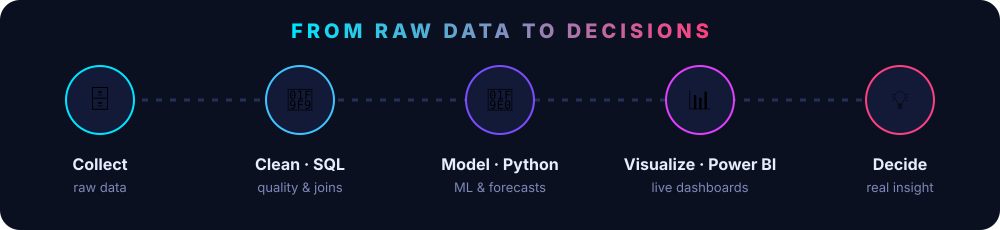

  

  
  
  
  

## About

I work in **data analytics, business intelligence and software development**. I turn raw data into clear insights and interactive dashboards, and I build practical web and application solutions.

- Data analysis, reporting and visualization with Power BI, Excel, SQL and Python
- Web and app development with Angular, Ionic, Laravel and PHP
- Currently exploring machine learning and data modeling
- Comfortable designing dashboards and working with stakeholders to support better decisions

## Skills

  

## Workflow

  

## GitHub Stats

<table align="center">
  <tr>
    <td align="center" width="50%">
      
    </td>
    <td align="center" width="50%">
      
    </td>
  </tr>
</table>

## Let's Connect

  Open to data analytics, BI and development opportunities. 
  Feel free to reach out — I'm happy to talk about a project or a role.

  
  
  

